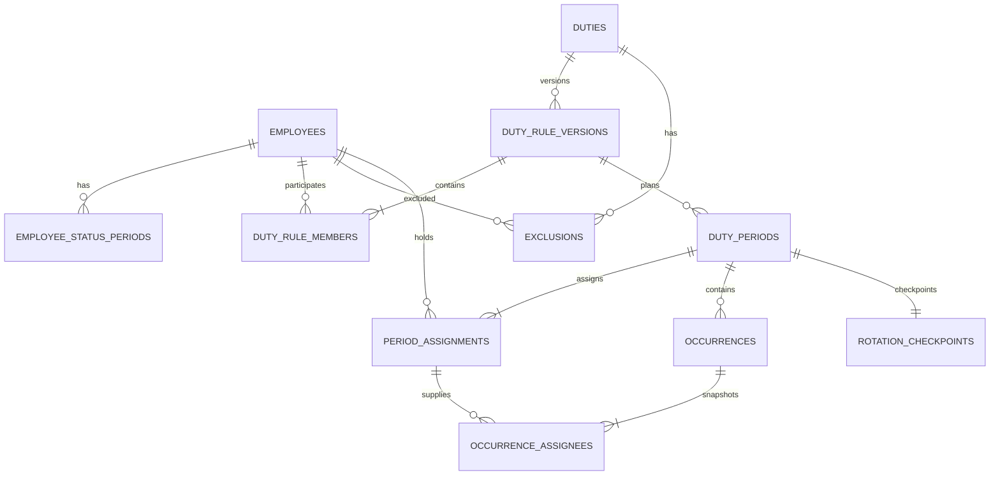

# DB 정책과 목표 논리 스키마

상태: MySQL 8.4 대상 설계 기준안. 이 문서는 실행 SQL이나 적용된 migration이 아니다.
현재 DB는 V1~V7의 19개 테이블이다. 담당 규칙 버전·복원·감사·잠금의 현행 구조는 [담당 변경 구현 명세](../../../docs/policies/assignment-change-implementation.md)를 따른다. [현행 실행일·자동 순환](../architecture/automatic-duties.md)과 이 문서의 목표 18개 테이블은 구분한다.
아래 테이블·필드는 후속 Flyway migration과 Java 구현으로 추가/변경한다.

## 1. 공통 저장 규칙

| 항목             | 목표                                                                                   |
| ---------------- | -------------------------------------------------------------------------------------- |
| 엔진             | InnoDB                                                                                 |
| 문자셋           | utf8mb4                                                                                |
| 일반 문자열 정렬 | utf8mb4_0900_ai_ci. 표시 이름은 unique 아님                                            |
| 식별 코드        | 정규화 사번·상태 코드·멱등 키는 ascii + ascii_bin, actor_subject는 utf8mb4_bin         |
| PK/FK            | signed BIGINT. Java Long과 일치. id는 외부 API에서 문자열                              |
| 버전             | BIGINT NOT NULL, 0 이상. 낙관적 잠금과 planningRevision에 사용                         |
| 업무 날짜        | DATE. Asia/Tokyo 달력 날짜, UTC 변환하지 않음                                          |
| 업무 시각        | TIME(0), 00:00~23:59, 초=0. 미지정은 NULL                                              |
| 기록 시각        | DATETIME(6)에 UTC Instant를 명시적으로 매핑                                            |
| 상태             | VARCHAR + CHECK + Java enum/string. DB ENUM·Java ordinal 사용 안 함                    |
| 공통 시각        | created_at/updated_at은 UTC. 필요하지 않은 updated_at을 append-only 이력에 만들지 않음 |
| 삭제 기본        | 이력 관계에는 ON DELETE RESTRICT. 업무 삭제 cascade 금지                               |

DATETIME은 자체적으로 UTC 값으로 바꿔 저장하는 타입이 아니다.
따라서 JDBC session·서버 변환을 UTC로 통일하고, 날짜형(LocalDate)과 기록 시각(Instant)을 별도로 매핑한다.
MySQL의 DATE/DATETIME/TIMESTAMP 차이는 [공식 시간 타입 문서](https://dev.mysql.com/doc/refman/8.4/en/datetime.html)를 따른다.
현재 V1의 TIMESTAMP와 connectionTimeZone 설정을 이미 위 정책으로 전환했다고 간주하지 않는다.

문자열 정규화·허용 문자·사번 충돌은 [업무 정책](../../../docs/policies/duty-policy.md)을 따른다.
반복 규칙·담당 기간은 [반개구간 start, endExclusive), 제외는 양 끝 포함이다. 컬럼명에서 차이를 드러낸다.

## 2. 관계 개요

단일 회사 서비스이므로 모든 테이블에 사용하지 않는 tenant_id를 미리 넣지 않는다.
회사 전체 계획 변경의 직렬화 기준으로 company_settings(id=1)을 사용한다.
직원 참여 관계를 member_ids JSON 한 컬럼으로 대체하지 않는다.

## 3. 테이블 사전

공통 id/created_at/updated_at/row_version은 필요한 테이블에 아래 정의와 함께 둔다.
문자열 길이는 화면·DTO 검증과 일치시킨다.

### company_settings

단일 row id=1. CHECK(id=1).

| 컬럼                   | 타입·제약            | 의미                           |
| ---------------------- | -------------------- | ------------------------------ |
| zone_id                | VARCHAR(64) NOT NULL | 첫 단계 Asia/Tokyo 고정        |
| working_weekdays_json  | JSON NOT NULL        | ISO 요일 1~7의 중복 없는 집합  |
| closing_time           | TIME(0) NULL         | 퇴근 시각. 알림 활성화 전 입력 |
| row_version            | BIGINT NOT NULL      | 설정 편집 충돌 검사            |
| planning_revision      | BIGINT NOT NULL      | 계획 입력/확정 변경마다 증가   |
| created_at, updated_at | DATETIME(6) NOT NULL | UTC                            |

근무 요일은 제한된 설정 집합이므로 JSON을 허용한다. 직원·업무 FK 관계를 JSON에 숨기는 예외가 아니다.

### calendar_overrides

| 컬럼                   | 타입·제약             | 의미                     |
| ---------------------- | --------------------- | ------------------------ |
| id                     | BIGINT PK             | 예외 ID                  |
| calendar_date          | DATE NOT NULL UNIQUE  | 회사 날짜별 한 가지 예외 |
| kind                   | VARCHAR(16) NOT NULL  | WORKDAY/HOLIDAY          |
| label                  | VARCHAR(100) NOT NULL | 会社休業日 등 안내       |
| row_version            | BIGINT NOT NULL       | 충돌 검사                |
| created_at, updated_at | DATETIME(6) NOT NULL  | UTC                      |

삭제/수정은 감사 기록 후 처리한다. 과거 예외 변경은 첫 단계에서 차단한다.
변경이 미래 확정 발생 건에 영향을 주면 calendar-change-preview 검토와 명시적 적용이 선행한다.

### employees / employee_status_periods

employees:
id PK, employee_number VARCHAR(40), normalized_employee_number VARCHAR(40) UNIQUE,
display_name VARCHAR(80), row_version, created_at, updated_at. 모두 NOT NULL.
정규화 사번은 ASCII 대문자 기준이며 업무 정책의 허용 문자와 길이를 검증한다.
사번은 비활성 직원도 재사용하지 않는다. 이름은 중복 허용.

employee_status_periods:
id PK, employee_id FK, status VARCHAR(16), effective_from DATE,
effective_to_exclusive DATE NULL, created_at.
UNIQUE(employee_id, effective_from).
겹치는 유효 구간·열린 구간이 둘 이상인 상황은 service가 회사 잠금 아래 차단한다.
미래 상태 변경 취소는 감사 후 구간을 복구한다. snapshot이 있는 과거 적용 내역을 소급 덮어쓰지 않는다.
현재 활성 여부만 저장한 V1 employees.active와 달리 날짜별 적격성을 복원하기 위한 구조다.

### duties

id PK, name VARCHAR(100), description VARCHAR(1000),
draft_payload_json JSON NULL, row_version, created_at, updated_at.
업무명은 중복 가능하되 UI에 동명 업무 경고를 제공한다.
draft_payload_json은 미운영 편집 초안만 담는다. 운영 시작 시 검증해 정규화된 버전/참여자에 저장하고 비운다.
업무 운영 상태는 오늘 적용되는 유효 RuleVersion에서 파생한다.

### duty_rule_versions

| 컬럼                        | 타입·제약             | 의미                                      |
| --------------------------- | --------------------- | ----------------------------------------- |
| id, duty_id                 | BIGINT PK / FK        | 업무 규칙 버전                            |
| version_no                  | INT NOT NULL          | UNIQUE(duty_id, version_no), 재사용 안 함 |
| state                       | VARCHAR(16) NOT NULL  | ACTIVE/PAUSED/ARCHIVED                    |
| effective_from              | DATE NOT NULL         | 적용 시작                                 |
| effective_to_exclusive      | DATE NULL             | 다음 버전 적용 시 닫는 경계               |
| canceled_at                 | DATETIME(6) NULL      | 적용 대기 버전 취소                       |
| change_reason               | VARCHAR(300) NOT NULL | 변경 사유                                 |
| schedule_type               | VARCHAR(32) NOT NULL  | 발생 규칙 코드                            |
| schedule_anchor_date        | DATE NULL             | 발생 간격 기준                            |
| schedule_interval_count     | SMALLINT NULL         | 규칙에 필요한 경우 1~365                  |
| local_time                  | TIME(0) NULL          | 시각 미지정 가능                          |
| holiday_policy              | VARCHAR(32) NOT NULL  | COMPANY_WORKDAYS/ALLOW_ON_HOLIDAYS        |
| month_day                   | TINYINT NULL          | 1~31                                      |
| missing_day_policy          | VARCHAR(32) NULL      | CLAMP_TO_LAST_DAY/SKIP                    |
| ordinal_in_month            | TINYINT NULL          | 1~5, LAST는 -1                            |
| weekday_in_month            | TINYINT NULL          | ISO 1~7                                   |
| rotation_type               | VARCHAR(32) NOT NULL  | CALENDAR_INTERVAL/EACH_OCCURRENCE         |
| rotation_anchor_date        | DATE NULL             | 기간 교대 기준                            |
| rotation_interval_count     | SMALLINT NULL         | 1~365                                     |
| rotation_unit               | VARCHAR(8) NULL       | DAY/WEEK/MONTH                            |
| assignee_count              | SMALLINT NOT NULL     | 1~20                                      |
| strategy                    | VARCHAR(32) NOT NULL  | EMPLOYEE_NUMBER/CUSTOM/SHUFFLED_ROUND     |
| conflict_policy             | VARCHAR(32) NOT NULL  | ALLOW_WITH_WARNING/FORBID                 |
| random_seed                 | BIGINT NULL           | 랜덤일 때만                               |
| algorithm_version           | VARCHAR(40) NOT NULL  | 순환 알고리즘 버전                        |
| initial_rotation_state_json | JSON NOT NULL         | 초기 실행 상태                            |
| created_at                  | DATETIME(6) NOT NULL  | UTC                                       |

INDEX(duty_id, effective_from), UNIQUE(duty_id, id).
유효 구간 겹침, 미래 대기 버전 최대 하나, 확정 구간 뒤 적용은 회사/duty 잠금 아래 검증한다.
canceled_at IS NULL 조건의 유일성을 단순 nullable UNIQUE로 해결했다고 가정하지 않는다.
본문은 불변. 유효 구간 끝/취소 메타데이터의 변경에는 audit가 필수다.
PAUSED/ARCHIVED 버전도 이전 규칙을 복제해 유효한 설정 본문을 보존하되 새 배정을 생성하지 않는다.

### duty_rule_members / rule_weekdays / rule_explicit_dates

- duty_rule_members: rule_version_id FK, employee_id FK, position_index INT,
  employee_number_snapshot VARCHAR(40). PK(rule_version_id, employee_id), UNIQUE(rule_version_id, position_index).
- rule_weekdays: rule_version_id FK, weekday TINYINT CHECK 1~7. PK(rule_version_id, weekday).
- rule_explicit_dates: rule_version_id FK, scheduled_date DATE. PK(rule_version_id, scheduled_date).

버전당 명단 1~200명, assignee_count 이하가 아닌지 service 검증한다.
규칙 type에 맞지 않는 하위 행은 거절한다. 하위 행은 운영 버전 생성 transaction에서 한 번 저장한다.

### exclusions

id PK, duty_id FK, employee_id FK, start_date DATE, end_date_inclusive DATE,
reason VARCHAR(300), canceled_at DATETIME(6) NULL, row_version, created_at, updated_at.
CHECK(start_date <= end_date_inclusive), INDEX(duty_id, employee_id, start_date, end_date_inclusive).
참여자·확정 담당 충돌은 service 검증한다. 취소 기록은 보존한다.
동일 직원·업무의 겹치는 유효 제외는 중복 등록을 막고 기존 항목 편집을 안내한다.

### duty_periods

id PK, duty_id FK, rule_version_id FK, period_key VARCHAR(100) UNIQUE,
ordinal BIGINT, start_date DATE, end_date_exclusive DATE,
source_occurrence_key VARCHAR(100) NULL, status VARCHAR(16),
duty_name_snapshot VARCHAR(100), duty_description_snapshot VARCHAR(1000),
confirmed_at DATETIME(6), confirmation_id CHAR(36), created_at.
UNIQUE(rule_version_id, ordinal), CHECK(start_date < end_date_exclusive).
INDEX(duty_id, start_date, end_date_exclusive), INDEX(confirmation_id).
version이 같은 duty에 속하는지 composite FK (duty_id,rule_version_id)로 보장할 후보 키를 둔다.

CALENDAR_INTERVAL의 기간 겹침은 service가 duty 잠금 아래 차단한다.
EACH_OCCURRENCE는 한 날짜에 다른 기간이 있을 수 있으므로 날짜 unique를 공통으로 걸지 않는다.
period_key는 버전/순번 또는 원래 발생 sourceKey에서 서버가 생성하며 이동 후에도 바꾸지 않는다.
confirmation_id는 확정 명령의 operationId(UUID)와 같다. 별도 confirmations master를 필요 없이 만들지 않는다.

### period_assignments

id PK, period_id FK, slot_index INT, employee_id FK,
employee_name_snapshot VARCHAR(80), employee_number_snapshot VARCHAR(40),
assignment_revision BIGINT, created_at, updated_at.
UNIQUE(period_id, slot_index), UNIQUE(period_id, employee_id), INDEX(employee_id, period_id).
slot_index는 0부터 시작하며 UI에는 1번부터 표시한다.
대타는 슬롯 ID를 유지한 채 employee와 snapshot을 갱신하고 audit를 남긴다.
과거 실제 담당은 아래 occurrence_assignees에서 보존한다.

### occurrences

id PK, duty_id FK, rule_version_id FK, period_id FK,
source_key VARCHAR(100), scheduled_date DATE, effective_date DATE,
local_time TIME(0) NULL, status VARCHAR(16), cancel_code VARCHAR(40) NULL,
change_reason VARCHAR(300) NULL, row_version, created_at, updated_at.
UNIQUE(rule_version_id, source_key), INDEX(effective_date, status, duty_id), INDEX(period_id, effective_date).
duty/version/period 소속을 (period_id,duty_id,rule_version_id) composite FK로 일치시킨다.
duty_periods에 UNIQUE(id,duty_id,rule_version_id), occurrences에 UNIQUE(id,period_id),
period_assignments에 UNIQUE(id,period_id)를 둔다.
CALENDAR_INTERVAL은 effective_date가 소속 period 구간에 속해야 한다. 이동 시 대상 period로 연결한다.
EACH_OCCURRENCE의 period는 해당 occurrence와 함께 날짜 구간을 갱신하며, ID와 checkpoint를 보존한다.
한 업무·같은 실제 날짜의 유효 발생 건 중복은 회사 잠금 아래 검사한다.
취소 행이 존재하는 날짜에 대한 재생성/복원은 취소 사유별로 판정한다.

### occurrence_assignees

occurrence_id FK, assignment_id FK, period_id FK, slot_index INT,
employee_id FK, employee_name_snapshot VARCHAR(80), employee_number_snapshot VARCHAR(40).
PK(occurrence_id, slot_index), UNIQUE(occurrence_id, employee_id).
(occurrence_id,period_id)와 (assignment_id,period_id)의 composite FK를 위해 참조 테이블에 대응 UNIQUE를 둔다.
employee_id는 현재 period_assignment의 employee와 항상 같을 필요가 없다.
대타 변경 전 이미 수행한 발생 건의 담당 snapshot을 보존하기 때문이다.

### rotation_checkpoints

period_id PK/FK, rule_version_id FK, algorithm_version VARCHAR(40),
state_after_json JSON, created_at DATETIME(6). 모두 NOT NULL.
CHECKPOINT는 append-only이며 순환 결과의 근거다.
(period_id,rule_version_id)는 duty_periods의 대응 UNIQUE 키로 composite FK를 둔다.
모든 배정/발생 건 저장이 성공한 확정 transaction에서만 삽입한다.
state_after_json의 schemaVersion·직원 ID 집합·큐 길이는 application에서 검증한다.
현재 algorithmVersion을 지원하지 못하면 이전 체크포인트를 임의로 해석하지 않고 차단한다.

### preview_sessions

id CHAR(36) PK, duty_id FK, preview_kind VARCHAR(32),
actor_subject VARCHAR(128), input_revision BIGINT, result_digest CHAR(64),
payload_json JSON, state VARCHAR(16), expires_at DATETIME(6), created_at DATETIME(6).
preview_kind는 DUTY_CONFIRMATION/CALENDAR_CHANGE다. 회사 캘린더 미리보기는 duty_id=NULL이다.
그 외 duty 확정 미리보기는 duty_id 필수다.
INDEX(expires_at), INDEX(duty_id, actor_subject).
payload는 임시 계산 snapshot이며 정식 배정 FK 관계를 대체하지 않는다.
기본 유효 15분, 만료/사용 데이터는 생성 후 1일이 지나면 정리할 수 있다.

### audit_events

id PK, actor_subject VARCHAR(128), action VARCHAR(64), aggregate_type VARCHAR(40),
aggregate_id VARCHAR(100), reason VARCHAR(300) NULL,
before_json JSON NULL, after_json JSON NULL, operation_id CHAR(36),
occurred_at DATETIME(6). INDEX(aggregate_type, aggregate_id, id), INDEX(operation_id).
정식 관계는 각 업무 테이블의 FK가 보장한다. 이력의 다형 참조는 DB FK 대신 type+id로 보관한다.
이름 snapshot과 변경 사실을 보존하며 HTTP 본문 전체·토큰·비밀번호를 그대로 저장하지 않는다.
앱의 일반 명령으로 이력을 수정·삭제하지 않는다.

### command_results

operation_id CHAR(36), actor_subject VARCHAR(128),
command_type VARCHAR(64), aggregate_id VARCHAR(100),
request_hash CHAR(64), http_status SMALLINT, response_json JSON,
committed_at DATETIME(6), expires_at DATETIME(6).
PK(actor_subject, operation_id), INDEX(expires_at).
같은 actor/key의 다른 command/resource/body도 재사용 충돌로 차단한다.
성공한 쓰기와 같은 transaction에 기록한다. rollback된 실패를 성공 결과로 남기지 않는다.
보존 기본 7일이며 이 기간 안에 동일 키 재시도 응답을 보장한다.
기간 이후의 같은 키를 재사용하지 않는 것은 클라이언트 계약이다.

## 4. DB 제약과 application 검증의 구분

DB:

- PK/FK, 명시적 UNIQUE, NOT NULL, 시작<끝, 범위, 허용 상태 CHECK.
- subtype에 따른 필수/불필요한 nullable 컬럼 CHECK는 가능한 범위에서 추가한다.

application + 잠금:

- 규칙/직원 상태의 기간 겹침, 한 개의 대기 버전.
- 배정 적격·인원 수·교차 업무 중복·연속 확정·회사 캘린더 영향.
- JSON 실행 상태의 멤버 참조, 순환 알고리즘 일치.
- occurrence가 해당 period에 속하는지와 subtype별 연결 변경.

CHECK만으로 다른 행·테이블의 업무 규칙까지 보장했다고 간주하지 않는다.
MySQL 지원 범위는 [공식 CHECK 문서](https://dev.mysql.com/doc/refman/8.4/en/create-table-check-constraints.html)를 참고한다.

## 5. 트랜잭션·동시성

회사의 규모가 작은 초기 단계에서는 정확성을 위해 계획 관련 모든 쓰기를 공통 잠금으로 직렬화한다.
쓰기 transaction은 READ COMMITTED로 시작하고 다음 순서를 지킨다.

1. company_settings(id=1) SELECT ... FOR UPDATE.
2. CommandResult를 확인한다. 같은 key/body의 성공이면 원래 응답을 반환하고 종료한다.
3. 관련 duties를 id 오름차순으로 잠근다.
4. expected version·PreviewSession·현재 상태·충돌을 다시 읽고 검증한다.
5. 변경·관계·checkpoint·audit·CommandResult를 저장한다.
6. planning_revision을 1 증가시키고 commit한다.

직원·제외·규칙·회사 캘린더·발생 건·확정·대타 변경이 이 규칙을 따른다.
메타데이터 변경도 preview의 snapshot을 바꾸므로 같은 경계를 따른다.
설정 자체 편집은 row_version도 함께 증가시킨다.
회사 공통 잠금은 교차 업무의 '양쪽 모두 빈 상태를 보고 동시 확정'하는 경쟁을 막기 위한 설계 선택이다.
중복 검사는 CANCELED 기간을 제외한 확정 배정의 실제 유효 날짜 구간을 대상으로 한다.
기본 격리 수준만 믿거나 duty 한 개의 잠금만으로 전사 중복 금지가 보장된다고 가정하지 않는다.

Preview는 REPEATABLE READ의 일관된 snapshot에서 입력을 모으되 배정 예약 잠금을 유지하지 않는다.
PreviewSession 저장·만료 정리·CommandResult 만료 정리는 계획 입력 변경이 아니므로 planning_revision을 증가시키지 않는다.
임시 PreviewSession 저장 transaction을 DB read-only transaction으로 선언하지 않는다.
이러한 임시 데이터 정리를 위해 회사 공통 계획 잠금을 장시간 유지하지 않는다.
확정 명령은 최신 데이터를 잠금 후 읽고 planning_revision 불일치를 409로 처리한다.
작업 중 원격 호출·메일·Pepper 동작을 transaction 안에서 수행하지 않는다.
잠금 timeout은 짧고 명시적으로 설정하며 rollback 후 503, 안전한 동일 키 재시도를 안내한다.
교착은 제한된 서버 재시도만 허용하고 멱등 결과를 확인한다.

FOR UPDATE가 transaction에서 잠금 읽기를 제공한다는 기술 근거는 [MySQL 공식 문서](https://dev.mysql.com/doc/refman/8.4/en/innodb-locking-reads.html)다.
전사 공통 잠금과 READ COMMITTED 선택은 이 서비스의 정책이며 MySQL이 자동 보장하는 업무 기능이 아니다.

## 6. 보존·정리·운영

- 직원 비활성, 업무 종료, 제외 취소, 발생 건 취소는 다른 의미다. 공통 deleted=true로 뭉개지 않는다.
- 유효 FK가 있거나 운영 이력이 생긴 직원·업무·규칙·기간은 hard delete하지 않는다.
- 초안 폐기는 audit 후 정책적으로 가능하지만 초기 UI는 초안 보관을 기본으로 한다.
- audit와 배정 이력은 첫 단계에 자동 만료하지 않는다. 회사 보존 정책이 정해지면 별도 설계로 추가한다.
- preview/멱등 임시 데이터 정리는 배치 단위로, 설정된 만료 시간과 audit 보존을 구분한다.
- DB migration 계정과 앱 계정 권한은 분리하고, 앱은 운영 중 DDL을 실행하지 않는다.
- 실제 백업 주기·복구 목표는 AWS 운영 단계에서 정한다. migration 전 백업과 복구 검증은 구현 배포 체크리스트에 포함한다.

## 7. V1에서의 이행

1. 적용된 V1 SQL 파일은 수정하지 않는다. 후속 버전의 expand/backfill/constraint 순서를 사용한다.
2. 스키마·현재 데이터·연결 시간대부터 확인한다. 존재하는 데이터를 임의의 예시 데이터로 대체하지 않는다.
3. 새 nullable 컬럼·테이블을 추가하고 전용 코드로 V1 rows를 변환한다.
4. 기존 duties의 주기는 CALENDAR_INTERVAL로 옮기되 업무 발생일은 알 수 없으므로 '일정 설정 필요'로 표시한다.
5. 기존 직원의 상태 변경 이력을 알 수 없으면 현재 상태를 이행 시작일부터 등록하고 과거 이력을 추정하지 않는다.
6. 기존 기간/배정을 보존한다. 수행 발생 건을 과거에 있었다고 가짜로 생성하지 않는다.
7. 과거 이름은 현재 JOIN 값밖에 없으면 LEGACY_IMPORT 근거를 남기고 당시 이름이라고 확신하지 않는다.
8. 현재 Random 알고리즘은 별도 LEGACY_V1으로 구분한다. 새 SHUFFLE_V1 결과로 과거·확정 담당을 덮어쓰지 않는다.
9. V1 배정 사이에 빈 기간이 있으면 자동 채우지 않는다. 관리자 이행 검토로 운영 시작점/checkpoint를 설정한다.
10. 사번 정규화 충돌·새 허용 문자 위반은 이행 보고서로 해결한다. 직원 ID를 합치거나 임의 사번을 발급하지 않는다.
11. 행 수·기간 경계·담당자·변경 이력 대조 후 NOT NULL/FK/CHECK를 강화한다.
12. 이행 중 쓰기를 중단하고 새 application service로 단일 쓰기 경로를 만든다.
    /api의 변경된 자료형과 클라이언트를 함께 배포한다. 초기 단계에 별도 구형 API/이중 쓰기를 유지하지 않는다.
13. MySQL 8.4에서 migration과 transaction/동시성 검증을 수행한다. H2 MySQL 모드 통과만으로 완료하지 않는다.

이행 코드·운영 시간·rollback 계획은 실제 DB 상태를 확인한 후 작성한다.
문서의 논리 스키마를 기존 데이터가 있는 DB에 통째로 재생성하는 방식은 사용하지 않는다.

## 現行実装: 明示的な当番削除

DELETE /api/duties/{id} はユーザーが確認ダイアログで確定した場合の物理削除である。通常更新で確定済み予定を保持する原則とは分けて扱う。DBの削除cascadeは追加せず、サービスのトランザクションと当番行ロックの下で関連履歴から本体までFK順に削除する。途中失敗時は全体をロールバックする。メンバー本体、会社休業日、ほかの当番は保持する。スキーマ変更は不要。

## 現行実装: メンバー情報の保守

名前・社員番号の編集では社員IDとactiveを維持し、割当・参加関係・履歴のFKを変更しない。関連が一切ないメンバーだけ物理削除する。関連ありの社員は無効化して保持する。削除の関連検査と実行は同一トランザクション／社員行ロック内で行い、FK制約を維持する。削除済み未使用レコードの社員番号は現在のunique制約では再利用できる。履歴のあるメンバーは削除不可のため番号を保持する。

## 규칙 변경의 우선 정책（2026-10-27）

[참가자·규칙 변경 정책](../../../docs/policies/rule-change-policy.md)을 우선한다. 적용 경계 이후 미래 자동 배정은 변경 미리보기 승인으로 갱신할 수 있고, 새 규칙도 기존의 다음 차례부터 이어간다. 조회·자동 저장을 보호 확정과 동일시해 적용일을 밀지 않는다. 과거·진행 중인 기간·수동 변경의 보호를 구분하고, 승인된 영향 전체와 규칙 버전·순환 상태·변경 전후 이력을 한 트랜잭션으로 반영하도록 설계한다. 현재 규칙 편집 API·버전 저장·보호 구분은 미구현이며, 새 필드·API·마이그레이션은 미합의 항목을 결정한 후 정의한다. 기존 확정 불변 원칙은 일반 조회·자동 갱신에 유지하며, 이번 명시적 규칙 변경 승인만 구분한다.
